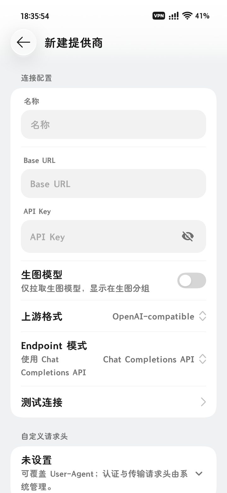
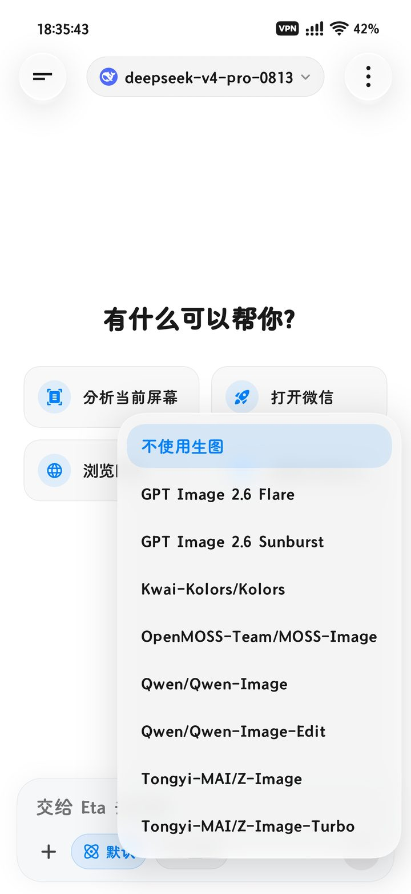
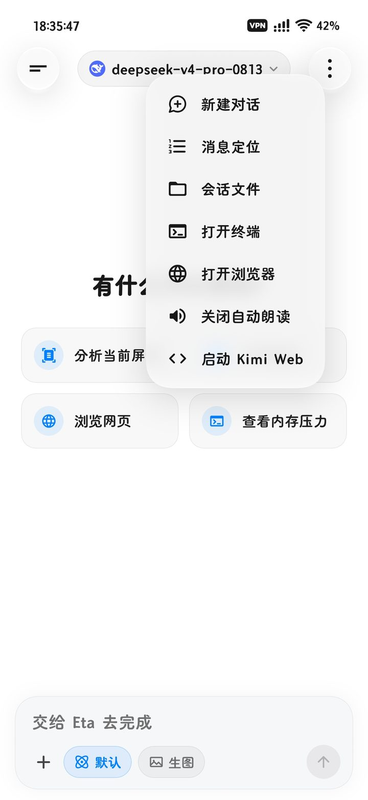

<h1 align="center">Eta</h1>

<strong>简体中文</strong> | <a href="README_EN.md">English</a>

<strong>基于上游 Eta 3.4.3 修改的第三方构建 · 当前版本 3.6.0</strong>

> **原版项目：[Mangi-11/Eta](https://github.com/Mangi-11/Eta)**
>
> 本仓库不是原版，下述功能全部是在上游代码上叠加或增强。
>
> 授权与原版一致，同为 **GPL-3.0**；源码与发布的 APK 一一对应。
> 功能说明、使用文档与问题反馈请以上游仓库为准。

---

## 基于哪个版本

| 项目 | 说明 |
| --- | --- |
| 上游基线 | **Eta 3.4.3**（tag `v3.4.3`，提交 `32e147a`）|
| 当前版本 | **3.6.0**（versionCode 2026111601）|
| 包名 | `io.github.mangi.eta.stable`，可与原版共存 |

从上游 3.4.3 起累积 81 个提交，下述功能全部是在上游代码上叠加或增强，
**没有删改上游任何既有能力**。

---

## 界面预览

下面是本构建的实际界面。

| 提供商配置 | 生图模型选择 |
| --- | --- |
|  |  |

左图：配置页内直接切换上游格式，生图开关位于 API Key 下方，Endpoint 模式行保留。
右图：生图模型单独列出，聊天模型不混入。

| 侧边栏 |
| --- |
|  |

---

## 一、自定义提示词

上游只允许在少数几个位置微调，本构建让整套系统提示词可写、可存、可回滚、可分享。

- **四段结构**：主身份、人格名、语气风格、追加指令，分别对应系统提示词的不同位置，可以只写其中一段
- **两种注入方式**
  - **替换**：顶替 Provider 自带的系统提示词，优先级最高
  - **追加**：原提示词完整保留，你的内容作为额外约束叠加在后面
- **改完点保存才生效**：编辑页是草稿模式，没点顶栏「保存」就退出，原配置一个字都不会变
- **版本与回滚**：内容真正变了才升版本，保留最近 5 个历史版本，随时回滚到任意一版；同样内容反复保存不会刷出一堆空版本
- **角色会话隔离**：进入角色扮演会话时，自定义提示词完全不注入，避免把角色人设顶掉
- **查看生效内容**：点「查看生效内容」能看到实际发出去的三段原文、包裹标签与当前版本号，不用猜有没有生效

## 二、提示词预设

- **内置一套「默认预设」**：装好即用，点一下套进草稿，不满意再改
- **预设可编辑**：不只是套用，预设本身的全部字段都能改、能存、能删
- **另存为预设**：编辑器顶栏书签图标，把当前草稿直接存成预设
- **导出分享**：预设打包成 zip，可以直接发给别人
- **导入**：zip、JSON、md、txt 都收，格式不用事先整理

**导入会自动认字段**，常见的写法都能识别：

| 类别 | 支持的键名 |
| --- | --- |
| 名称 | `name`、`title`、`preset_name` |
| 提示词内容 | `system_prompt`、`systemPrompt`、`system`、`prompt`、`content`、`instruction`、`instructions`、`text` |
| 描述 | `description`、`desc`、`summary`、`note` |

另外还认 `messages[role=system].content`、`system_instruction.parts[0].text`、顶层数组取首项这几种结构；zip 里优先找 `preset.json`，没有就取任意一个 `.json`。单包上限 256KB、单字段上限 20000 字符，zip 解压侧同样限流。

## 三、AI 生图

上游只能对话，本构建让 Agent 可以直接出图。

- **对话内生成**：Agent 调用生图工具，产物落盘并可选自动存入系统相册，聊天里可回看大图
- **输入栏生图入口**：填好提示词一点即出，支持设置尺寸、生成数量（1～4 张）、是否自动存相册
- **中转站兼容**：接口不认 `response_format` / `n` / `size` 时自动换端点、降级重试，并把原始报错带出来
- **专属图标**：生图按钮使用独立图标，与思考按钮区分

## 四、提供商配置

新增与编辑页共用同一套连接字段，上游格式在页内直接切换，不必退回列表重选入口。

- **上游格式页内切换**：OpenAI 兼容 / Anthropic Messages / Gemini Interactions 三选一；新建时可随时改，已存在的提供商固定自身类型，避免误改导致模型配置丢失
- **字段随类型显隐**：`anthropic-version`、联网搜索等专属字段按当前类型即时出现或隐藏，不再依赖初始实例
- **生图模型开关**：独立开关，位置在 API Key 正下方；打开即按 OpenAI 兼容协议只拉取生图模型，聊天模型自动排除。Anthropic 与 Gemini 没有生图接口，这两类页面不显示该开关
- **Endpoint 模式跟随协议栈**：只要走 OpenAI 兼容（含生图提供商）且用 API Key 登录就显示，修复开启生图开关后 Endpoint 行消失的问题
- **新增入口合并**：四个新增入口合并为一项「新增模型提供商」，副标题标明支持的上游格式
- **独立分组**：模型提供商列表把生图提供商单独成段，不再与对话提供商混排
- **编辑弹窗适配**：生图模型不要求填上下文窗口、隐藏思考档位，但保留默认尺寸、默认格式、接口地址三项生成参数

## 五、本地离线语音识别

上游的语音识别全部依赖云端服务，本构建增加了一条完全离线的路径。

- **本机推理**：接入 sherpa-onnx，中文流式 zipformer2 模型，边说边出字
- **不联网、不需要密钥**：录音不会上传
- **模型按需下载**：引擎随 APK 打包，模型在选中「本地离线」后按需下载，带进度、可取消、可删除、逐文件 SHA-256 校验
- **两个入口都能用**：聊天输入框听写与助手浮窗语音输入共用同一条识别管道

## 六、系统 TTS 播报

- **调用手机自带语音引擎**：不联网、不需要密钥、不产生费用
- 音色与效果由系统语音设置决定，与上游的云端播报并存，在播报服务下拉里可选

## 七、消息定位

- **整会话范围定位**：侧栏呼出消息导航，覆盖全部历史轮次，点任意一条直接跳到该轮对话
- **分页加载**：页大小改为 256，长会话定位不再只覆盖最近一段
- 无标题轮次给出可辨识的占位文案

## 八、会话文件管理

- **会话文件列表**：按会话汇总发过的附件，随时回看与取回
- 空会话给出明确提示，不会出现空白面板

## 九、长回答分段选择复制

- **长回答不再只能整段复制**：按段落选择，逐段复制想要的部分
- 复制行为独立实现，不触发系统文本选择浮层

## 十、提供商列表整理

- **三段排序**：顶栏排序按钮支持按「名称（中文拼音排序）/ 接口类型 / 配置状态」整理顺序
- **已配置与未配置分组**：列表拆成两组，已配置的排前面
- **凭据判定**：已配置的判据是「有模型且有可用凭据」，内置但没有 Key 的不会挤占分组
- **服务商分组折叠**：模型选择弹层改为设置页式分组卡，分组默认折叠，去掉冗余标签与筛选行

## 十一、模型能力识别

- **按模型名补齐档位**：打开编辑弹窗即看到建议的上下文窗口与思考档位，不用手动填
- **修复上下文窗口显示「未知」**：生效窗口原来只读手改值，远端返回的窗口字段看不见，现已补上回退
- **中转站跨目录识别**：自定义服务商自身目录查不到时，按 modelId 到 OpenAI / Anthropic / Gemini 官方目录再查一遍，同 id 模型的窗口与思考档位可正常带出
- **预设覆盖主流家族**：gpt-6.1、gpt-6、gpt-5.6、gpt-5、claude、gemini、glm、qwen、deepseek、kimi、minimax、step，最长前缀优先
- **历史记录自动补齐**：已入库但没有窗口/档位字段的模型，读取时在内存中补齐，不回写数据库，手改值依然优先，无需重新拉取
- **新增模型即时预填**：编辑弹窗输入 Model ID，窗口与档位立刻按预设填入
- **输出上限预留**：模型表新增输出 token 上限（远端值 + 用户覆盖）

## 十二、权限健康：公共目录访问

- **设置 → 权限健康** 新增「公共目录访问」一项
- 检测的是系统「所有文件访问」（`MANAGE_EXTERNAL_STORAGE`）是否已授予，未授予直接显示「授权」
- 点一下**直接跳到系统的授权页**，不用再翻进工作区与文件页里找
- 授权后终端与文件工具可直接读写 `/storage/emulated/0` 及各类共享目录
- 从授权页返回时列表状态自动刷新，不需要手动退出重进

## 十三、输入框统一改造

- **标签固定**：字段标签固定在框内左上角，不再随输入内容跳动
- **高度自适应**：默认 1 行，随内容增长，最多 6 行
- **字数与 token**：每个输入框下方显示「N 字 · 约 N token」，写长提示词时心里有数
- **全屏编辑**：长文本点「全屏编辑」进占满屏幕的编辑器，改起来不挤
- **粘贴 / 清空**：每个输入框下方都有快捷操作
- **编辑消息提示**：「发送后将替换此消息」移进输入框内部，不再和对话正文叠在一起看不清

## 十四、其他体验改进

| 项目 | 说明 |
| --- | --- |
| 首 token 等待占位 | 等待首个 token 期间有占位动画，不再是空白 |
| 用户气泡长按 | 只触发一次震动，不再弹系统文本选择 |
| 正在思考文案 | 去掉末尾省略号 |
| 虚拟屏输入法策略 | 修复输入法策略失败导致虚拟屏刚建好就被销毁 |
| 虚拟屏胶囊 | 窗口宽度固定，展开收起不再左右跳动 |
| 虚拟屏重排 | 画面与动作行重新排布 |
| 启动首帧 | 不再被磁盘 IO 阻塞 |
| 会话加载 | 旧版双重转义 checkpoint 不再拖崩加载 |
| 自动压缩阈值 | 上下文占用达窗口 80% 才触发（此前 70%），减少长任务中途压缩次数 |
| 统计弹窗 | 居中与提示条描边缺口修复 |
| Miuix 聊天列表 | 修复单向滚动失效 |

## 十五、构建与发布

- **正式版与测试版共存**：正式版派生 `.stable` 包名，与测试版签名不同、可同时安装
- **签名回落**：环境变量优先，缺省回落仓库根 `keystore.properties`，本机可直接出正式包
- **CI 门禁**：仅发版标签与手动触发跑 lint 与单元测试，日常推送不占用 runner
- **发版覆盖**：同一版本重复发版时原地覆盖资产，不再产生两份安装包

---

## 安装

当前版本 **3.6.0**（versionCode 2026111601），正式版包名 `io.github.mangi.eta.stable`，与上游原版签名不同、包名不同，可以同时安装。

从本仓库的 Releases 下载 APK 安装即可。从旧版本升级时数据库会自动迁移，会话、模型与设置均保留。

支持 **Android 13 及以上、ARM64 设备**。

---

## 从 3.5.0 升到 3.6.0

- **新增**：自定义提示词（四段结构、替换/追加两种注入、版本回滚、角色会话隔离）
- **新增**：提示词预设（内置默认预设、预设可编辑、导入导出、查看生效内容）
- **新增**：输入框统一改造（标签固定、高度自适应、字数与 token、全屏编辑、粘贴清空）
- **新增**：权限健康页「公共目录访问」入口
- **变化**：内置预设精简为一套「默认预设」，原先的多套破甲预设已移除
- **修复**：「发送后将替换此消息」从输入框上方移进框内，不再与对话正文重叠

数据库自动迁移，会话与设置全部保留，直接覆盖安装即可。

---

## 与原版的关系

- 原版项目：[Mangi-11/Eta](https://github.com/Mangi-11/Eta)
- 原版文档与功能说明：请访问上方仓库
- 本构建源码：[amos023/Eta](https://github.com/amos023/Eta)（即本仓库，与发布的 APK 一一对应）
- 本仓库仅承载上述增量改动，不提供独立的功能文档

如果你只是想要原版功能，建议直接使用原版。

---

## 许可证与修改声明

本构建基于 GPL-3.0 授权分发，许可证全文见仓库根目录 [LICENSE](LICENSE)，并随 APK 打包于 `assets/licenses/GPL-3.0.txt`。

相对上游 `Mangi-11/Eta` 的修改自 2026-11-09 起由 amos023 作出，改动范围见上文各节。对应源码完整公开在本仓库，未作任何删减。
