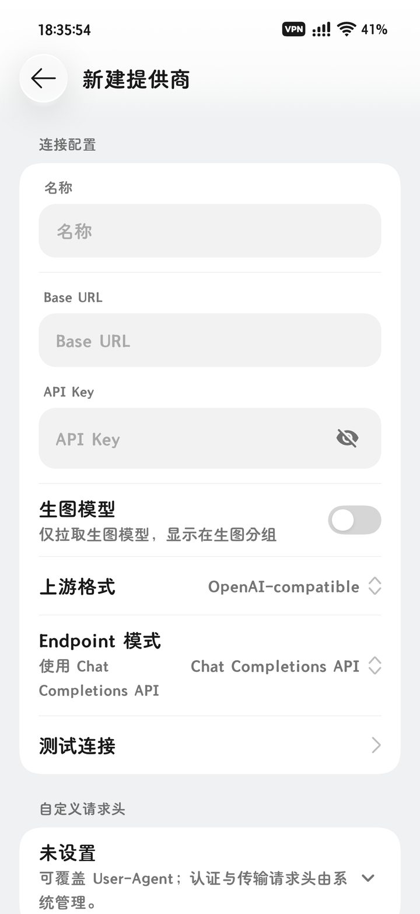
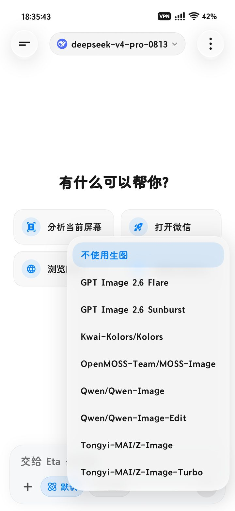
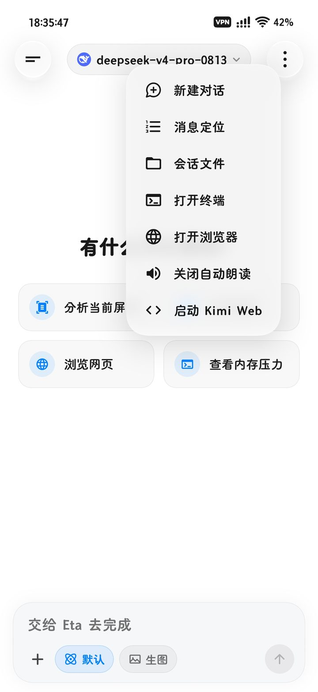

<h1 align="center">Eta</h1>

<a href="README.md">简体中文</a> | <strong>English</strong>

<strong>A third-party build based on upstream Eta 3.4.3 · current version 3.6.0</strong>

> **Original project: [Mangi-11/Eta](https://github.com/Mangi-11/Eta)**
>
> This repository is published independently from a modified upstream source tree.
> It is not the original, nor a GitHub fork. Eta's design, core implementation and all
> base capabilities come from the upstream authors; everything here is additive —
> **nothing from upstream is removed, downgraded or changed**, only the capabilities
> listed below are added.
>
> Licensed the same way as upstream, under **GPL-3.0**; the source matches the released
> APK one to one. For feature documentation, usage guides and issue reports, please
> refer to the upstream repository.

---

## Based on which version

| Item | Value |
| --- | --- |
| Upstream baseline | **Eta 3.4.3** (tag `v3.4.3`, commit `32e147a`) |
| This build | **3.6.0** (versionCode 2026111601) |
| Package name | `io.github.mangi.eta.stable`, coexists with the original |

81 commits accumulated since upstream 3.4.3. Everything below is layered on top of
upstream code. **Nothing from upstream was removed or degraded.**

---

## Screenshots

Actual UI of this build.

| Provider configuration | Image model picker |
| --- | --- |
|  |  |

Left: the upstream format switches in place; the image-only switch sits below the API key
and the Endpoint mode row remains. Right: image models are listed separately, chat models
are not mixed in.

| Sidebar |
| --- |
|  |

---

## 1. Custom system prompts

Upstream only allows a few tweaks here and there; this build makes the whole system prompt
writable, savable, rollable-back and shareable.

- **Four-part structure**: main identity, persona name, tone/style, additional instructions — each maps to a different slot in the system prompt, and any part may be left empty
- **Two injection modes**
  - **Replace**: takes over the provider's own system prompt, highest priority
  - **Append**: the original prompt is fully kept and your content is layered on as extra constraints
- **Saved, not auto-applied**: the editor is a draft. Leaving without tapping Save in the top bar changes nothing
- **Versions and rollback**: a version only increments when the content really changes; the last 5 versions are kept and any of them can be restored. Re-saving identical content does not pile up empty versions
- **Roleplay isolation**: inside a roleplay session the custom prompt is not injected at all, so the character persona is never overridden
- **Effective-content view**: shows the three actual blocks sent out, their wrapper tags and the current version number — no guessing whether it took effect

## 2. Prompt presets

- **One built-in "Default preset"**: usable right after install, tap to load it into the draft and edit freely
- **Editable presets**: not just applicable — every field of a preset can be changed, saved and deleted
- **Save as preset**: the bookmark icon in the editor top bar stores the current draft as a preset
- **Export and share**: presets pack into a zip you can hand to someone else
- **Import**: zip, JSON, md and txt are all accepted, no pre-formatting required

**Import recognises common field names automatically:**

| Kind | Accepted keys |
| --- | --- |
| Name | `name`, `title`, `preset_name` |
| Prompt content | `system_prompt`, `systemPrompt`, `system`, `prompt`, `content`, `instruction`, `instructions`, `text` |
| Description | `description`, `desc`, `summary`, `note` |

It also understands `messages[role=system].content`, `system_instruction.parts[0].text`, and a top-level array (first item taken). Inside a zip it prefers `preset.json`, otherwise any `.json`. Limits: 256 KB per archive, 20 000 characters per field, with the same bound enforced on the unzip side.

## 3. AI image generation

Upstream is text-only; this build lets the Agent produce images directly.

- **In-chat generation**: the Agent calls an image tool, results are saved to disk and optionally to the system gallery, and can be reviewed in chat
- **Input bar entry**: type a prompt and tap to generate; supports size, count (1–4) and auto-save
- **Relay compatibility**: when an endpoint rejects `response_format` / `n` / `size`, it retries other endpoints and degrades gracefully, surfacing the original error
- **Dedicated icon**: the image button no longer shares the thinking icon

## 4. Provider configuration

The new and edit screens share one set of connection fields; the upstream format is switched in place instead of picking a different entry from the list.

- **In-page format switch**: OpenAI-compatible / Anthropic Messages / Gemini Interactions. New providers can switch at any time; existing ones keep their own type so a mistaken switch cannot drop model configuration
- **Fields follow the type**: `anthropic-version`, hosted web search and similar fields appear or hide immediately, no longer depending on the initial instance
- **Image-only switch**: a standalone switch right below the API key. Turning it on fetches image models only over the OpenAI-compatible protocol and excludes chat models. Anthropic and Gemini have no image endpoint, so the switch is hidden there
- **Endpoint mode follows the protocol stack**: shown whenever OpenAI-compatible (image providers included) with API-key auth is used, fixing the Endpoint row disappearing after enabling image-only
- **Merged entry point**: four "add provider" entries collapse into one, with the supported formats named in the summary
- **Separate group**: the provider list splits image providers into their own section
- **Kept out of chat**: image models never appear in the chat model picker, whichever path fetched them
- **Editor adaptation**: image models skip the context window requirement and hide reasoning settings, while keeping default size, format and endpoint

## 5. Local offline speech recognition

Upstream speech recognition is entirely cloud-based; this build adds a fully offline path.

- **On-device inference**: sherpa-onnx with a Chinese streaming zipformer2 model, transcribing as you speak
- **No network, no API key**: audio never leaves the device
- **Model on demand**: the engine ships in the APK; the model downloads when "Local offline" is selected, with progress, cancel, delete and per-file SHA-256 verification
- **Works in both entry points**: chat dictation and the assistant overlay share the same recognition pipeline

## 6. System TTS playback

- **Uses the device's built-in speech engine**: no network, no key, no cost
- Voice and quality follow the system speech settings; available alongside upstream's cloud playback

## 7. Message navigation

- **Whole-conversation navigation**: open the navigator from the side pane to browse every turn and jump straight to it
- **Paged loading**: page size raised to 256, so navigation no longer only covers the most recent stretch of a long conversation
- Untitled turns get a recognisable placeholder label

## 8. Conversation file management

- **Per-conversation file list**: every attachment sent in a conversation, browsable and retrievable
- Empty conversations show a clear hint instead of a blank panel

## 9. Segmented copy for long answers

- **Long answers are no longer all-or-nothing**: select and copy individual paragraphs
- Bypasses the system text selection overlay

## 10. Provider list organisation

- **Three sort modes**: a top-bar button sorts by name (Chinese pinyin collation), endpoint type, or configuration state
- **Configured vs unconfigured**: the list is split into two groups with configured providers first
- **Credential-based**: "configured" means it has models **and** usable credentials, so built-ins without a key no longer crowd the group
- **Collapsible provider groups**: the model picker becomes a settings-style grouped card with collapsed groups, dropping redundant tags and filter rows

## 11. Model capability detection

- **Presets by model name**: opening the editor shows suggested context window and reasoning levels instead of empty fields
- **Fixed "unknown context"**: the effective window only read the user override, hiding the value the remote API returned; a fallback is now in place
- **Cross-catalogue detection for relays**: when a custom provider's own catalogue misses, the model ID is looked up in the OpenAI / Anthropic / Gemini catalogues, so windows and reasoning levels resolve correctly
- **Presets cover major families**: gpt-6.1, gpt-6, gpt-5.6, gpt-5, claude, gemini, glm, qwen, deepseek, kimi, minimax, step, longest prefix first
- **Existing records backfilled**: models stored without window or level fields are filled in memory on read without writing back, so user overrides still win and no re-fetch is needed
- **Instant prefill**: typing a model ID in the editor fills the window and levels from the preset immediately
- **Output limit reserved**: the model table gains an output token limit (remote value plus user override)

## 12. Permission health: all-files access

- A new **Settings → Permission health** entry, "All files access"
- It checks whether `MANAGE_EXTERNAL_STORAGE` is actually granted; when it is not, the row shows an Authorise action
- One tap **jumps straight to the system authorisation page**, so you no longer have to dig through the workspace and files screens
- Once granted, the terminal and file tools can read and write `/storage/emulated/0` and every shared directory directly
- Returning from the system page refreshes the row automatically, no need to back out and re-enter

## 13. Unified input fields

- **Fixed labels**: field labels stay pinned to the top-left inside the box and no longer jump with content
- **Auto height**: one line by default, growing with content up to 6 lines
- **Counts**: each field shows "N chars · ~N tokens" underneath, useful when writing long prompts
- **Full-screen editing**: long text opens a full-screen editor so it is not cramped
- **Paste / clear**: shortcut actions under every field
- **Edit notice**: "Sending will replace this message" moved inside the field and no longer overlaps the conversation body

## 14. Other refinements

| Item | Detail |
| --- | --- |
| First-token placeholder | A placeholder animation covers the wait for the first token |
| User bubble long-press | Vibrates once and no longer opens system text selection |
| "Thinking" label | Trailing ellipsis removed |
| Virtual display IME policy | Fixed the failure that destroyed a virtual display right after creation |
| Virtual display capsule | Fixed width, no more horizontal jumping when expanding or collapsing |
| Virtual display layout | Reworked the preview and action row arrangement |
| First frame | No longer blocked by disk IO at startup |
| Conversation loading | Legacy double-escaped checkpoints no longer break loading |
| Auto-compaction threshold | Triggers at 80% of the window (was 70%), cutting mid-task compactions |
| Stats dialog | Fixed centring and the summary bar border gap |
| Miuix chat list | Fixed one-way scrolling |

## 15. Build and release

- **Stable and debug coexist**: the release build derives a `.stable` package name with its own signature, so both can be installed at once
- **Signing fallback**: environment variables take priority, falling back to `keystore.properties` in the repo root, so release builds work locally
- **CI gate**: lint and unit tests only run on release tags and manual dispatch, keeping routine pushes off the runner
- **Release overwrite**: republishing the same version overwrites the asset in place instead of creating a duplicate install

---

## Install

Current version **3.6.0** (versionCode 2026111601). The release build uses package name
`io.github.mangi.eta.stable`. It has a different signature and package name from upstream,
so both can be installed side by side.

Download the APK from this repository's Releases. Upgrading from an older version
migrates the database automatically; conversations, models and settings are kept.

Requires **Android 13+ on ARM64 devices**.

---

## Upgrading 3.5.0 → 3.6.0

- **New**: custom system prompts (four-part structure, replace/append injection, version rollback, roleplay isolation)
- **New**: prompt presets (built-in default preset, editable presets, import and export, effective-content view)
- **New**: unified input fields (fixed labels, auto height, char/token counts, full-screen editing, paste and clear)
- **New**: "All files access" entry on the permission health screen
- **Changed**: built-in presets reduced to a single "Default preset"; the previous jailbreak-style presets were removed
- **Fixed**: the "Sending will replace this message" notice moved inside the input field instead of overlapping the conversation body

The database migrates automatically; conversations and settings are preserved, so an
install-over is enough.

---

## Relationship to upstream

- Original project: [Mangi-11/Eta](https://github.com/Mangi-11/Eta)
- Feature docs and upstream usage: visit the repository above
- Source of this build: [amos023/Eta](https://github.com/amos023/Eta) (this repository, matching the released APK)
- This repository only carries the additions listed here and does not provide standalone documentation

If you only need the original feature set, use upstream directly.

---

## License and modification notice

This build is distributed under GPL-3.0. The full text is in [LICENSE](LICENSE) at the repository root
and is bundled in the APK as `assets/licenses/GPL-3.0.txt`.

Modifications relative to upstream `Mangi-11/Eta` have been made by amos023 since 2026-11-09;
the scope is the sections above. The corresponding source is published in full in this repository
with nothing removed.
